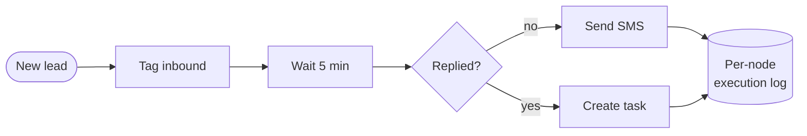

 

&nbsp;

&nbsp;

---

I'm a software developer building **SiloCRM** and **SiloCSM** for **JWeis Marketing**, and before that for Sharetasking Inc. Most of my recent work is LLM application engineering: a real-time voice agent on ElevenLabs ConvAI, AI-written SMS on Twilio, RAG with per-tenant knowledge-base sync, MCP tools that expose CRM data to agents, and a visual workflow automation engine.

I care about the part most LLM work skips: proving the thing actually works. That's why I built [EvalLab](https://github.com/iamshihab2020/evallab).

**Open to senior full-stack and LLM application roles**, remote with US teams.

---

## What I'm shipping at work

**SiloPilot**, a per-tenant AI agent for calls, SMS and email. It qualifies leads, books appointments, collects data and routes calls, each agent on a tenant-owned Twilio number. My part:

- the **ElevenLabs ConvAI voice integration**: real-time WebSocket, document store and RAG, agent provisioning
- the **Twilio layer**: calling, conference calls and AI-written SMS replies
- **webhook ingest** for transcripts, audio and conversation events
- **MCP integrations** and tool use for call transfer and data collection
- the **AI agents management UI**

**The workflow automation engine.** A no-code canvas (React Flow and Zustand) on a custom Fastify execution engine: **33 triggers, 20+ actions**, conditional branches. It walks the graph **breadth-first, one depth at a time**, and logs every node, so each run can be replayed. The header above is that idea, animated. A real workflow looks like this:

> Both live in a private company repo. Everything below is my own public work.

---

## Selected work

| Project | What it is | Links |
| --- | --- | --- |
| **EvalLab** | LLM evaluation platform. LLM-as-judge scoring on accuracy, completeness, tone and safety; run-to-run regression checks; failure clustering; judge calibration against humans with Cohen's κ. Next.js, FastAPI, PostgreSQL. | [repo](https://github.com/iamshihab2020/evallab) · [live](https://evallab-pearl.vercel.app/) |
| **Zaxvio CRM** | Multi-tenant field-service SaaS for small HVAC teams: scheduling, invoicing, customer history. Turborepo with Next.js, Fastify, Supabase and Drizzle. Built solo. | [repo](https://github.com/iamshihab2020/zaxvio-crm) · [live](https://zaxvio-crm-web.vercel.app) |
| **Bangla sentiment fine-tuning** | How much labelled data a QLoRA-tuned 1–2B model needs to match BanglaBERT, on a 6 GB laptop GPU. Reproduced the published baseline and found 7.2% train/test leakage in SentNoB. | [repo](https://github.com/iamshihab2020/bangla-sentiment-finetuning) |
| **TabbyDeck** | Turns a phone or tablet into a Stream Deck for Windows. Node host, Preact deck and editor, 399 tests. Open source. | [repo](https://github.com/iamshihab2020/TabbyDeck) · [site](https://iamshihab2020.github.io/TabbyDeck/) |
| **DropMate** | Chat and send files to people at home over your own Wi-Fi. Windows and Android, no cloud, no account. Flutter. | [repo](https://github.com/iamshihab2020/DropMate) |
| **TabDeck** | A feature-packed new-tab page for Chrome. My most-starred repo. | [repo](https://github.com/iamshihab2020/tabdeck) |

---

## Research

**Autism Spectrum Disorder Identification from Facial Images Using Fine-Tuned Pre-trained Deep Learning Models and Explainable AI Techniques** 
Hossain, S. S., et al. (2025). *Semarak International Journal of Applied Psychology*, 5(1), 29–53. First author. 
Compared 12 fine-tuned CNNs; DenseNet121 reached 90.33% accuracy and 90.00% F1. LIME and Grad-CAM show which facial regions drive each prediction.

---

## Stack

  

<b>The full stack, by layer</b>

 

**LLM**: prompt and context engineering · agents and tool calling · MCP · RAG · structured outputs · LLM-as-judge evaluation · QLoRA fine-tuning

**Interface**

**Service**

**Data and infra**

**Practice**

<b>How I work</b>

 

- **Design the API before writing it.** The contract is what matters; the handler is a detail.
- **Tenant isolation belongs in the database.** With PostgreSQL row-level security, a missing `WHERE` clause fails the query instead of leaking data.
- **Measure before trusting.** An LLM feature without a regression check has no way to tell you it broke. That's why EvalLab exists.
- **I use Claude Code and Cursor every day**: directing agents, curating context, and reviewing what they write.

---

## Activity

  

---

## Let's talk

I'm looking for senior full-stack roles, especially LLM application work: multi-tenant SaaS, agent plumbing, workflow tooling, anywhere the engineering has a real job to do.

Outside code, it's history, storytelling and the occasional YouTube rabbit hole. Happy to swap notes on either.

 

&nbsp;

